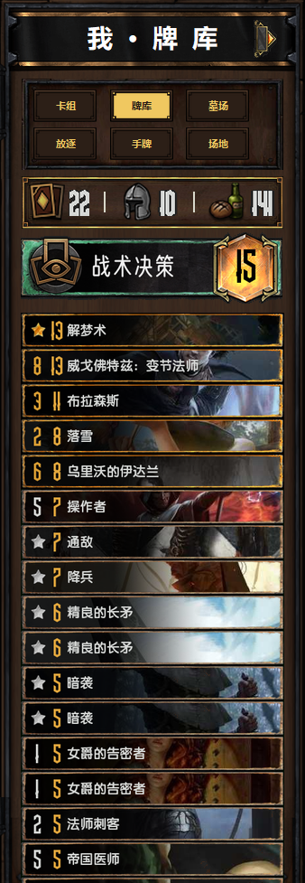
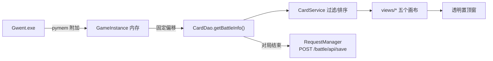

# GwentWanHuaMirror · 昆特记牌器（桌面端）

**对局中把双方牌库实时列在屏幕边上，打完结顺手把战报传上去。**

昆特牌没有官方记牌器：对手还剩几张牌、自己牌库还剩什么，全靠记。
这个 Windows 小工具用透明置顶窗贴出双方的牌库/手牌/墓场，逐张显示卡图、人口与战力；
对局结束把整场战报 POST 给服务端，成为网站卡组数据的来源之一。

  



↑ 我·牌库：标题/页签/统计（22 张、10 单位、14 人口），领袖卡带人口徽章，往下逐张排（新出现的牌白框高亮）。
主控制窗见 [docs/screenshots](docs/screenshots/05-desktop-main.png)。

## 这是什么

1. 启动时 `pymem` 附加 `Gwent.exe`，按版本偏移读出 `GameInstance`，拿到双方牌表；
2. `tkinter` 画一张透明置顶窗，把牌库/手牌/墓场按页签列出来，鼠标可拖动、双击关闭；
3. 对局结束（`GameStatus == ENDED` 且不是单人/观战/友谊赛）把战报 POST 给服务端。

它跑不进 Linux 容器——必须附加游戏进程。没有游戏时用 `gui_demo.py` 离线看界面。

## 能干什么

- **对手还剩什么牌** —— 敌·牌库/手牌/墓场分页签列出，预测卡组可做差异对比
- **自己的牌库实时对账** —— 抽到/打出/被弃的牌从列表里消失，墓地单独成页
- **不挡视野** —— 无边框透明窗，`WS_EX_LAYERED` 抠掉底色，可拖动、双击关闭
- **打完自动上报** —— 只报有效对局，单人/观战/友谊赛自动跳过；可关「共享卡组」只统计不采集牌表
- **不开游戏也能出界面** —— `gui_demo.py` 只替换内存读取层，其余全用原版代码

## Quick Start

真机（需要游戏正在运行）：

```bash
cd main
pip install pymem pillow ttkbootstrap pywin32
python GwentMirror.py        # 先把 resources/config/global_config.json 的 url 指到你的服务端
```

没有游戏，只想看界面：

```bash
cd .                          # desktop/ 根目录
pip install pillow ttkbootstrap pywin32
python gui_demo.py --target both      # 主窗 + 悬浮窗各截一张
```

更多参数（指定页签、敌方视角、输出目录）见 [docs/getting-started.md](docs/getting-started.md)。

## 用起来是什么样

| 步骤 | 干什么 | 注意 |
| --- | --- | --- |
| 1 | 先起服务端（容器或本地后端） | `resources/config/global_config.json` 的 `url` |
| 2 | 启动游戏，再启动记牌器 | 顺序反了会弹「检测到游戏未启动」 |
| 3 | 主窗点「我方 / 对方」的开启 | 弹出对应悬浮窗，拖到顺手的位置 |
| 4 | 打完一局 | 自动上报；单人/观战/友谊赛/竞技场不报 |
| 5 | 游戏更新后读不到数据 | 点主窗「更新」页拉新版本偏移 |

## 怎么实现的



- **寻址**：`GameAssembly.dll` 基址 + `version.json` 的 `address` 偏移，一路解引用到 `GameInstance`
- **装配**：`initCtData()` 把每张牌读成 `{Id, PlayId, Location, Provision, BasePower, …}`，再按位置/玩家过滤
- **渲染**：背景板、标题栏、页签、状态栏、卡牌列表五个 Canvas 叠成一张窗，牌图逐张贴上去

细节见 [docs/architecture.md](docs/architecture.md)，上报报文见 [docs/api.md](docs/api.md)。

## 部署方式

| 方式 | 命令 | 适用 |
| --- | --- | --- |
| 源码运行 | `python main/GwentMirror.py` | 开发/自用 |
| 打包 exe | `pyinstaller GwentMirror.spec` | 分发给别人 |
| 离线看界面 | `python gui_demo.py --target both` | 没有游戏/只想截图 |

## 文档

| 文档 | 内容 |
| --- | --- |
| [getting-started](docs/getting-started.md) | 真机前置条件、离线复现、打包 exe |
| [architecture](docs/architecture.md) | 内存寻址链路、目录、五个画布的职责 |
| [api](docs/api.md) | 上报报文全字段、另两个同步接口 |
| [troubleshooting](docs/troubleshooting.md) | 检测不到游戏、更新后读不到、素材缺失 |

## 说明

- 版权归原作者 [@1053278842](https://github.com/1053278842)；本仓库补了 README、
  文档与离线复现脚本，未改动业务代码。
- 截图来自 `gui_demo.py` 的真实渲染（原版界面代码 + 原版素材），不是设计稿。
- 只支持 Windows；内存偏移与游戏版本强绑定，游戏一更新就要重新校对。

<details>
<summary>English</summary>

Windows overlay tracker for Gwent: reads the game process memory to list both decks
in a transparent always-on-top window, and uploads the battle report when the match ends.
Runs only on Windows; `gui_demo.py` reproduces the UI without the game for screenshots.

</details>