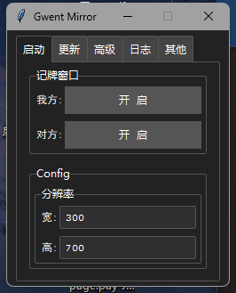

# 安装与运行

## 前置

| 项 | 要求 |
| --- | --- |
| 系统 | Windows 10/11（`pymem` / `win32gui` / `win32api` 都是 Windows 专用） |
| Python | 3.10+（`tkinter` 随 Python 自带） |
| 依赖 | `pymem`、`pillow`、`ttkbootstrap`、`pywin32` |
| 游戏 | 真机运行时需要 `Gwent.exe` 正在运行 |
| 服务端 | 一个能访问的 GwentMirror 服务（容器或本地后端） |

## 真机运行

```bash
cd main
pip install pymem pillow ttkbootstrap pywin32
# 先把 resources/config/global_config.json 的 url 指到你的服务端，例如
#   {"url": "http://localhost:8081", ...}
python GwentMirror.py
```

三条前置条件，缺一条就起不来：

1. 游戏在运行（否则 `PanelManager` 直接弹「检测到游戏未启动」并退出）；
2. `resources/config/version.json` 的 `address` 与当前游戏版本匹配
   （不匹配就点主窗「更新」页去服务器拉新的版本记录）；
3. 服务端 URL 在 `global_config.json` 的 `url`，默认是作者的线上库。

## 离线复现界面（不用游戏）

`gui_demo.py` 把「读内存」这层换掉，界面代码和素材保持原样，用于截图/演示：

```bash
cd .                          # desktop/ 根目录
pip install pillow ttkbootstrap pywin32
python gui_demo.py --target both                  # 主窗 + 悬浮窗
python gui_demo.py --target overlay --tab 手牌     # 指定页签
python gui_demo.py --target overlay --enemy       # 敌方视角
python gui_demo.py --out-dir ./shots              # 换输出目录
```

`--tab` 可选：`卡组` / `牌库` / `墓场` / `放逐` / `手牌` / `场地`。

替换了哪些东西：

| 原始实现 | demo 里的替身 |
| --- | --- |
| `pymem.Pymem("Gwent.exe")` | 注入假 `pymem` 模块，`read_longlong/read_bytes` 返回 0 |
| `CardService.get_all_cardTemplates()` | 从 `resources/data/decks.json` 取一副素材齐全的卡组，摊平成 `initCtData()` 的字段结构 |
| 当前玩家 / 双方 id / 牌库实例 id 区间 | 固定值（`getCurrBattleInfo` / `getPlayerCarriedCarInsIds` 等几个函数打桩） |
| `GwentGUI` 与 `views/*` | **原样调用** |
| 卡图、UI 切图、字体 | **原文件** |

截图前会垫一层深色窗口再抓屏，因为悬浮窗本身是
`overrideredirect + WS_EX_LAYERED（colorkey 0x222222）` 的透明置顶窗口，
直接抓屏会把桌面/浏览器一起拍进去。

主控制窗（原始 geometry 250×280，内容比它高，截图时按内容自适应高度）：



## 打包 exe

```bash
cd desktop
pyinstaller GwentMirror.spec      # 产出 dist/GwentMirror.exe，单文件、无控制台
```

`GwentMirror.spec` 是原作者留下的：入口 `main/GwentMirror.py`、`console=False`、
图标 `main/resources/images/favicon/Beer.ico`、加密 key `8848taihejing`。
打包前确认 `main/resources` 里的配置与图片都在。

## 与服务端对接

| 配置 | 位置 | 说明 |
| --- | --- | --- |
| `url` | `resources/config/global_config.json` | 服务端根地址，如 `http://localhost:8081` |
| `comparative` | 同上 | 是否做「预测卡组差异对比」 |
| `sorting` | 同上 | 是否按真实牌库顺序显示 |
| `automaticSubmit` | 同上 | 关掉后只统计对局，不在战报里带牌表 |
| 版本偏移 | `resources/config/version.json` | 由主窗「更新」页从 `/version/api/getId` 拉取 |
| 面板尺寸 | `resources/config/panelCoords.json` | 悬浮窗宽高，主窗「分辨率」里也能改 |